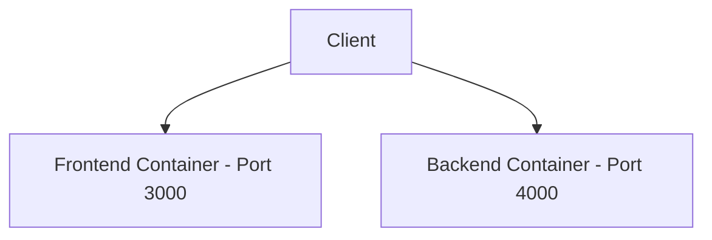

# Microservices & Containerization

## Week 1 – Microservices & Containerization Foundation

## 1. Project Overview

This project demonstrates the development and containerization of two independent microservices using **Node.js, Express.js, and Docker**.

The project consists of:

- **Frontend Service:** An HTTP service that provides health-check and service information endpoints.
- **Backend Service:** A JSON API that provides health-check and service information endpoints.

Each service has its own source code, dependencies, Dockerfile, and Docker image. Both services run independently in separate Docker containers.

## 2. Architecture



## 3. Technologies Used

- Node.js
- Express.js
- Docker
- Docker Multi-Stage Builds
- Alpine Linux
- Git and GitHub

## 4. Prerequisites & Tool Versions

The following tools were used during development:

| Tool | Installed Version |
|---|---|
| WSL | 3.0.5.0 |
| Docker | 29.6.2 |
| Node.js | v22.15.0 |
| npm | 11.6.4 |
| kubectl Client | v1.36.1 |
| Kustomize | v5.8.1 |
| Helm | v4.3.2 |
| Terraform | v1.16.4 |

## 5. Project Structure

```text
Microservices-Containerization/
│
├── services/
│   ├── frontend/
│   │   ├── src/
│   │   │   └── server.js
│   │   ├── Dockerfile
│   │   ├── .dockerignore
│   │   ├── package.json
│   │   └── package-lock.json
│   │
│   └── backend/
│       ├── src/
│       │   └── server.js
│       ├── Dockerfile
│       ├── .dockerignore
│       ├── package.json
│       └── package-lock.json
│
└── README.md
```

## 6. Service Endpoints

Both services provide two endpoints:

| Service | Endpoint | Port |
|---|---|---:|
| Frontend | `/health` | 3000 |
| Frontend | `/info` | 3000 |
| Backend | `/health` | 4000 |
| Backend | `/info` | 4000 |

## 7. Docker Implementation

Both services use multi-stage Docker builds.

**Key Docker features:**

- Lightweight `node:22-alpine` base image.
- Separate builder and production stages.
- Production dependencies installed using `npm ci --omit=dev`.
- `.dockerignore` files to exclude unnecessary files.
- Non-root user with UID `1001`.
- Separate Docker images for both services.

## 8. Build Docker Images

Run these commands from the project root directory.

**Frontend:**

```bash
docker build -t frontend-service:v1 ./services/frontend
```

**Backend:**

```bash
docker build -t backend-service:v1 ./services/backend
```

## 9. Run Docker Containers

**Frontend:**

```bash
docker run -d --name frontend-container -p 3000:3000 frontend-service:v1
```

**Backend:**

```bash
docker run -d --name backend-container -p 4000:4000 backend-service:v1
```

If you have already created containers with these names, remove them before running the commands again:

```bash
docker rm -f frontend-container backend-container
```

## 10. Verify Running Containers

Check whether both containers are running:

```bash
docker ps
```

## 11. Test API Endpoints

Use the following commands to test both services from Windows PowerShell:

**Frontend:**

```powershell
curl.exe http://localhost:3000/health
curl.exe http://localhost:3000/info
```

**Backend:**

```powershell
curl.exe http://localhost:4000/health
curl.exe http://localhost:4000/info
```

**Verification:** All four endpoints returned successful JSON responses when tested through the running Docker containers.

## 12. Container Security Verification

Both containers were configured to run as a non-root user.

**Verification commands:**

```bash
docker exec frontend-container id
docker exec backend-container id
```

**Verified output:**

```text
uid=1001(appuser) gid=101(appgroup) groups=101(appgroup)
```

Both containers successfully ran with **UID 1001**, satisfying the non-root user requirement.

## 13. Learning Outcomes

Through this project, I practiced:

- Building independent microservices.
- Creating and configuring Dockerfiles.
- Understanding multi-stage Docker builds.
- Building and tagging Docker images.
- Running and managing Docker containers.
- Testing HTTP endpoints using curl.
- Applying non-root container execution for better security.

---

**Internship:** 6-Week DevOps Internship Program  
**Week:** 01 – Microservices & Containerization Foundation