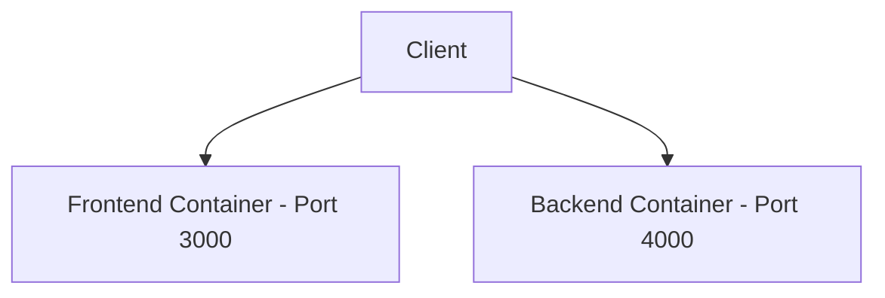

# Microservices & Containerization

# Week 1 – Microservices & Containerization Foundation

## 1. Project Overview

This project demonstrates the development and containerization of two independent microservices using **Node.js, Express.js, and Docker**.

The project consists of:

- **Frontend Service:** An HTTP service that provides health-check and service information endpoints.
- **Backend Service:** A JSON API that provides health-check and service information endpoints.

Each service has its own source code, dependencies, Dockerfile, and Docker image. Both services can run independently in separate Docker containers.

## 2. Architecture



## 3. Technologies Used

- Node.js
- Express.js
- Docker
- Docker Multi-Stage Builds
- Alpine Linux
- Git and GitHub

## 4. Prerequisites & Tool Versions

The following tools were used during development:

| Tool | Installed Version |
|---|---|
| WSL | 3.0.5.0 |
| Docker | 29.6.2 |
| Node.js | v22.15.0 |
| npm | 11.6.4 |
| kubectl Client | v1.36.1 |
| Kustomize | v5.8.1 |
| Helm | v4.3.2 |
| Terraform | v1.16.4 |

## 5. Project Structure

```text
Microservices-Containerization/
│
├── services/
│   ├── frontend/
│   │   ├── src/
│   │   │   └── server.js
│   │   ├── Dockerfile
│   │   ├── .dockerignore
│   │   ├── package.json
│   │   └── package-lock.json
│   │
│   └── backend/
│       ├── src/
│       │   └── server.js
│       ├── Dockerfile
│       ├── .dockerignore
│       ├── package.json
│       └── package-lock.json
│
├── helm/
│   └── microservices/
│       ├── Chart.yaml
│       ├── values.yaml
│       └── templates/
│           ├── frontend-deployment.yaml
│           ├── frontend-service.yaml
│           ├── backend-deployment.yaml
│           └── backend-service.yaml
│
├── kubernetes/
│   ├── kind-config.yaml
│   └── security/
│       └── mtls-policy.yaml
│
└── README.md
```

## 6. Service Endpoints

Both services provide two endpoints:

| Service | Endpoint | Port |
|---|---|---:|
| Frontend | `/health` | 3000 |
| Frontend | `/info` | 3000 |
| Backend | `/health` | 4000 |
| Backend | `/info` | 4000 |

## 7. Docker Implementation

Both services use multi-stage Docker builds.

**Key Docker features:**

- Lightweight `node:22-alpine` base image.
- Separate builder and production stages.
- Production dependencies installed using `npm ci --omit=dev`.
- `.dockerignore` files to exclude unnecessary files.
- Non-root user with UID `1001`.
- Separate Docker images for both services.

## 8. Build Docker Images

Run these commands from the project root directory.

**Frontend:**

```bash
docker build -t frontend-service:v1 ./services/frontend
```

**Backend:**

```bash
docker build -t backend-service:v1 ./services/backend
```

## 9. Run Docker Containers

**Frontend:**

```bash
docker run -d --name frontend-container -p 3000:3000 frontend-service:v1
```

**Backend:**

```bash
docker run -d --name backend-container -p 4000:4000 backend-service:v1
```

If you have already created containers with these names, remove them before running the commands again:

```bash
docker rm -f frontend-container backend-container
```

## 10. Verify Running Containers

Check whether both containers are running:

```bash
docker ps
```

## 11. Test API Endpoints

Use the following commands to test both services from Windows PowerShell.

**Frontend:**

```powershell
curl.exe http://localhost:3000/health
curl.exe http://localhost:3000/info
```

**Backend:**

```powershell
curl.exe http://localhost:4000/health
curl.exe http://localhost:4000/info
```

**Verification:** All four endpoints returned successful JSON responses when tested through the running Docker containers.

## 12. Container Security Verification

Both containers were configured to run as a non-root user.

**Verification commands:**

```bash
docker exec frontend-container id
docker exec backend-container id
```

**Verified output:**

```text
uid=1001(appuser) gid=101(appgroup) groups=101(appgroup)
```

Both containers successfully ran with **UID 1001**, satisfying the non-root user requirement.

## 13. Learning Outcomes

Through this project, I practiced:

- Building independent microservices.
- Creating and configuring Dockerfiles.
- Understanding multi-stage Docker builds.
- Building and tagging Docker images.
- Running and managing Docker containers.
- Testing HTTP endpoints using curl.
- Applying non-root container execution for better security.

---

# Week 2 – Helm, Service Mesh & mTLS

## 1. Overview

During Week 2, the frontend and backend microservices were deployed to a local Kubernetes cluster using Helm. Linkerd was integrated as the service mesh to provide mutual TLS (mTLS) between meshed workloads and identity-based authorization for service-to-service communication.

The backend was protected using Linkerd authorization policies so that only the authorized frontend workload could access it.

## 2. Technologies Used

- Kubernetes
- Kind (Kubernetes in Docker)
- Helm
- Linkerd Service Mesh
- Mutual TLS (mTLS)
- Kubernetes ServiceAccounts
- Server and ServerAuthorization policies
- PowerShell

## 3. Kubernetes Cluster

A local Kubernetes cluster was created using Kind.

**Cluster name:** `week2-cluster`

**Configuration file:**

```text
kubernetes/kind-config.yaml
```

The frontend and backend services were deployed inside the `microservices` namespace.

## 4. Helm Implementation

A Helm chart was created to manage the deployment of both microservices.

**Helm chart location:**

```text
helm/microservices/
```

The chart includes:

- `Chart.yaml` – Chart metadata and version.
- `values.yaml` – Configurable deployment values.
- `frontend-deployment.yaml` – Frontend Kubernetes Deployment.
- `frontend-service.yaml` – Frontend Kubernetes Service.
- `backend-deployment.yaml` – Backend Kubernetes Deployment.
- `backend-service.yaml` – Backend Kubernetes Service.

**Install the application:**

```powershell
helm install microservices ./helm/microservices --namespace microservices
```

**Validate the chart:**

```powershell
helm lint ./helm/microservices
```

**Check the release:**

```powershell
helm status microservices -n microservices
```

The Helm release was deployed successfully, and the chart passed validation.

## 5. Linkerd Service Mesh

Linkerd was installed to provide service mesh functionality and secure communication between the microservices.

The Linkerd CRDs and control plane were installed using the Linkerd CLI.

The `microservices` namespace was configured for automatic Linkerd proxy injection.

Both frontend and backend pods ran with two containers:

- Application container.
- Linkerd proxy sidecar.

This enabled service-to-service communication through the Linkerd service mesh.

## 6. mTLS Authorization Policy

A Linkerd `Server` policy was configured for the backend service on port `4000`.

The backend policy uses:

```yaml
accessPolicy: deny
```

This ensures that access is denied by default unless an authorization rule allows it.

A `ServerAuthorization` policy was also configured to allow access from the frontend ServiceAccount:

```yaml
client:
  meshTLS:
    serviceAccounts:
      - name: frontend
        namespace: microservices
```

**Security configuration:**

- Backend access is restricted by default.
- Frontend uses its dedicated ServiceAccount.
- Authorized frontend-to-backend traffic is allowed.
- Unauthorized meshed workloads are denied access.

## 7. Security Verification

Three tests were performed to verify the authorization policy.

### Test 1: Authorized Frontend Access

The frontend service accessed the backend `/info` endpoint.

**Result:**

```text
HTTP: 200

Response:
{"service":"backend","description":"Backend JSON API microservice","version":"1.0.0","port":"4000"}
```

The frontend was successfully authorized to access the backend.

### Test 2: Unauthorized Workload Access

An unauthorized meshed workload attempted to access the backend `/info` endpoint.

**Result:**

```text
HTTP/1.1 403 Forbidden
```

The unauthorized workload was successfully denied access.

### Test 3: Unauthorized Un-injected Workload

A separate workload without a Linkerd proxy sidecar attempted to access the backend `/info` endpoint.

**Result:**

```text
HTTP/1.1 403 Forbidden
```

The request was denied by the backend's Linkerd authorization policy.

## Week 2 – Final Verification and Results

### Deployment Verification

The frontend and backend microservices were successfully deployed using the parameterized Helm chart.

- Helm release: `microservices`
- Namespace: `microservices`
- Helm revision: `4`
- Frontend deployment: Successfully rolled out
- Backend deployment: Successfully rolled out
- Both application pods running with Linkerd sidecars (2/2 containers ready).

### Health Probes

Updated Kubernetes readiness and liveness probe configurations for both services.

| Setting | Value |
|---|---|
| Health endpoint | `/health` |
| Probe interval | 10 seconds |
| Probe timeout | 5 seconds |
| Failure threshold | 3 |

The probe timeout was increased from 1 to 5 seconds to improve tolerance under local cluster load.

### Linkerd Service Mesh and Security

Linkerd was installed using its CLI. Automatic sidecar injection was enabled for the `microservices` namespace.

Configured Linkerd resources:

- `Server`: backend-server
- `ServerAuthorization`: frontend-to-backend
- Backend access policy: deny by default
- Authorized identity: frontend ServiceAccount in the microservices namespace
- Authorization mechanism: Linkerd meshTLS identity-based authorization.

### Security Testing Results

| Test | Expected result | Actual result |
|---|---|---|
| Authorized frontend to backend `/info` | HTTP 200 | HTTP 200 |
| Unauthorized meshed workload to backend | HTTP 403 | HTTP 403 |
| Unauthorized un-injected workload to backend | HTTP 403 | HTTP 403 |

The tests demonstrate successful frontend communication and denial of unauthorized access.
The HTTP 403 responses demonstrate that unauthorized access was denied. The Linkerd meshTLS identity configuration and injected proxies provide the service-mesh security mechanism; the HTTP status codes alone are not independent proof of encrypted traffic.

### Final Helm Validation

- `helm lint ./helm/microservices` completed successfully.
- Helm chart lint validation completed successfully.
- Helm upgrade completed successfully.
- Helm upgrade completed successfully.
- Frontend and backend rollout status checks succeeded.
- Linkerd overall status checks passed, with a warning about control-plane proxy version status.

### Installation Note

Linkerd was installed using the Linkerd CLI rather than Helm. The application microservices themselves were packaged and deployed using Helm.

### Week 2 Outcome

Frontend and backend microservices are managed through a parameterized Helm chart and protected using Linkerd service-mesh identity-based authorization. Authorized communication and unauthorized access-denial tests were successfully demonstrated.

## 8. Learning Outcomes

Through Week 2, I practiced:

- Creating and managing Helm charts.
- Deploying microservices to Kubernetes using Helm.
- Working with a local Kind Kubernetes cluster.
- Installing and configuring Linkerd.
- Enabling automatic sidecar proxy injection.
- Understanding service mesh architecture.
- Configuring mTLS-based service authorization.
- Working with Kubernetes ServiceAccounts.
- Creating Linkerd Server and ServerAuthorization policies.
- Testing authorized and unauthorized service communication.

---

**Internship:** 6-Week DevOps Internship Program  
**Weeks Completed:** 01 and 02